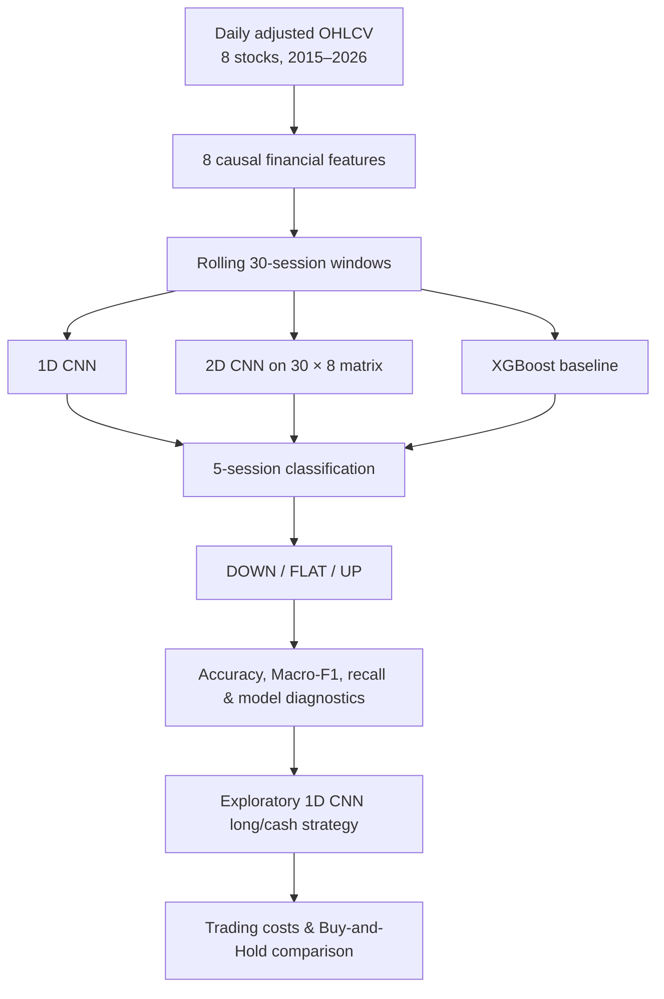

# CNN Market Signal Classification

**Financial Time-Series Classification | 1D CNN vs 2D CNN vs XGBoost | Exploratory Algorithmic Trading**

A research-oriented Python study investigating whether convolutional neural networks can recognize patterns in financial time series, classify **five-session-ahead market direction**, and generate economically meaningful trading signals. The experiments cover **eight stocks (seven European, one US)** using historical market data.

> **Main finding:** Class-weighted CNNs slightly improve validation Macro-F1 over XGBoost, but their directional skill remains weak and **classification performance does not consistently translate into trading outperformance**. The exploratory CNN strategy beats Buy & Hold in only **3 of 8 stocks**.

[**Explore the executed Jupyter Notebook**](cnn_market_signal_classification.ipynb)

## Research questions

1. Can CNN filters learn useful local patterns directly from multivariate financial time series?
2. Does a **2D time-series representation** outperform a simpler **1D CNN** for market-direction classification?
3. Do predicted directions lead to useful trading decisions **after transaction costs**?

## Research pipeline



### What do the signals mean?

The models output **predicted classes**, not investment recommendations. Each class refers to the realized close-to-close return over the next five trading sessions, relative to the signal date:

| Predicted class | Future five-session return | Meaning |
|:--|:--|:--|
| **DOWN (0)** | Below −2% | Predicts a sufficiently large decline |
| **FLAT (1)** | From −2% to +2% (inclusive) | Predicts a relatively small price movement |
| **UP (2)** | Above +2% | Predicts a sufficiently large increase |

The separate, explicitly designed **research trading rule** is *UP → long*, *DOWN/FLAT → cash*; it does not follow automatically from the classification labels.

## Dataset and feature design

The notebook uses **24,011 recorded daily observations** over January 2015–October 2026, downloaded through Yahoo Finance (`yfinance`) with adjusted historical OHLCV prices. The local snapshot is stored as `market_data.csv` when the notebook is executed; it is not required in this repository.

| Country | Company | Yahoo Finance ticker | Sector |
|:--|:--|:--|:--|
| Italy | Leonardo | `LDO.MI` | Aerospace & defence |
| France | Thales | `HO.PA` | Aerospace & defence |
| Italy | Prysmian | `PRY.MI` | Industrial cables / energy infrastructure |
| Netherlands | ASML | `ASML.AS` | Semiconductor equipment |
| Spain | Repsol | `REP.MC` | Energy |
| Italy | UniCredit | `UCG.MI` | Banking |
| Germany | Siemens | `SIE.DE` | Industrial technology |
| United States | JPMorgan Chase | `JPM` | Banking |

**Eight input features:** 1-day return, 5-day return, 10-day momentum, 20-day rolling volatility, relative volume, high–low range, open-to-close movement, and the relative distance from the 20-day moving average. Each sample uses **30 consecutive historical sessions × 8 features**.

### How a time series becomes a CNN input


*Figure 1 — A standardized 30 × 8 input window. Rows are financial variables, columns are successive trading days; color encodes standardized feature values, not buy/sell labels.*

**1D CNN:** filters move along time and see all feature channels. **2D CNN:** filters operate across both time and the chosen ordering of features. This is an *image-like numerical matrix*, **not** a candlestick image; feature adjacency in a 2D convolution does not have an established economic meaning. Our 2D architecture is inspired by, but **does not reproduce**, the 15 × 15 technical-indicator image construction in Sezer & Ozbayoglu (2018).

### Can we inspect the learned representations?


*Figure 2 — Activations from the first convolutional layer over one historical input window. Strong activations indicate that a learned filter responds to a local pattern; they are **not proof** of financial predictability or economic causality.*

## Modeling and evaluation

| Component | Setup |
|:--|:--|
| Baselines | Majority-class (`DummyClassifier`) and XGBoost |
| Deep learning | Compact 1D CNN, weighted 1D CNN, weighted 2D CNN (TensorFlow/Keras) |
| Inputs | Identical underlying 30 × 8 data for model comparison |
| Training period | 2015–2021 |
| Validation period | 2022–2023 |
| Scaling | `StandardScaler` fitted on training features only |
| Label alignment | Five-session targets constrained within the time-split boundary |
| Main metric | **Macro-F1**, supplemented by balanced accuracy, class-level recall and confusion matrices |

> **Evaluation caveat:** Data from **2024–2026 was already inspected during earlier development**, so it cannot be represented as a pristine final test set. All headline comparisons below are **validation / exploratory results**, not independently confirmed out-of-sample estimates.

### Validation performance (2022–2023)

| Model | Accuracy | Balanced accuracy | Macro-F1 |
|:--|--:|--:|--:|
| **Weighted 2D CNN** | 0.3746 | 0.3663 | **0.3640** |
| Weighted 1D CNN | 0.3758 | 0.3668 | 0.3637 |
| XGBoost | 0.4159 | **0.3695** | 0.3399 |
| 1D CNN (unweighted) | **0.4219** | 0.3636 | 0.2996 |
| Majority-class baseline | 0.4043 | 0.3333 | 0.1919 |


*Figure 3 — Macro-F1 comparison across model variants on the 2022–2023 validation period.*

**Interpretation:** The weighted 2D and 1D CNNs are effectively tied: **0.3640 vs 0.3637** Macro-F1 (difference **0.0003**). Although weighting increases Macro-F1, the best balanced accuracy is only about **37%**, slightly above the three-class chance reference of **33.3%**. A higher accuracy alone can conceal poor performance for directional classes when `FLAT` is frequent.

### Which classes can the models recognize?

| Validation recall | DOWN | FLAT | UP |
|:--|--:|--:|--:|
| XGBoost | 0.09 | **0.72** | 0.30 |
| Weighted 1D CNN | 0.26 | 0.37 | **0.47** |
| Weighted 2D CNN | **0.34** | 0.46 | 0.30 |


*Figure 4 — Per-class recall reveals the trade-off: XGBoost strongly favors FLAT; weighted CNNs distribute recognition more evenly, with different strengths for DOWN and UP.*

**Research takeaway:** Different neural representations change *which movements are detected*, but neither CNN yields reliably strong classification across all directions. The class-weighting experiment illustrates how optimizing for minority-class recall can reduce overall accuracy.

## Exploratory algorithmic trading experiment

To connect forecasts with an economic outcome, the **weighted 1D CNN** supplies the signals for a simple **long/cash** strategy:

- Predict at the **close** of session *t*; enter a long position at the **next session's open** only for `UP`.
- Exit at the **close of session t+5**; schedule decisions without overlapping holding windows per stock.
- Remain in **cash** for `DOWN` and `FLAT` signals (no short positions).
- Apply an assumed **0.10% transaction cost per side** to executed trades; compare against a continuously invested Buy & Hold proxy.

These are **research assumptions**, not broker quotes or executable recommendations. Target labels use close-to-close returns while the backtest uses next-open-to-fifth-close execution; the difference can affect realized performance.

### Trading results — 2022–2023 validation sample

| Stock | CNN long/cash | Buy & Hold |
|:--|--:|--:|
| Leonardo | +24.32% | +134.25% |
| Thales | +3.38% | +83.68% |
| Prysmian | +32.19% | +25.20% |
| ASML | +10.23% | −1.24% |
| Repsol | +3.71% | +38.96% |
| UniCredit | +34.20% | +95.69% |
| Siemens | −15.44% | +15.34% |
| JPMorgan | +16.81% | +9.75% |


*Figure 5 — Cumulative trading returns of the weighted 1D CNN long/cash rule versus Buy & Hold. The CNN strategy outperformed for **3 of 8 stocks** (Prysmian, ASML, JPMorgan), but substantially lagged several rising equities.*

The backtest comprises **811 non-overlapping decisions** across the eight stock series: **372 UP entries**, **244 FLAT** and **195 DOWN** cash decisions. The CNN results are **not a portfolio**, nor are they evidence that a profitable live-trading system has been developed. Differing market exposure is important when interpreting the comparison.

## Key findings and limitations

**What the experiments suggest:**

1. **CNNs can extract localized temporal features**, as shown by convolutional activations, but feature learning alone does not prove useful predictive information.
2. **Class weighting improves Macro-F1** relative to an unweighted 1D CNN, particularly by reducing the failure to detect DOWN signals.
3. **1D and 2D CNN performance is practically indistinguishable** on overall validation Macro-F1; superiority of time-series-to-image conversion is not established.
4. **A classification improvement is not the same as a trading edge.** The exploratory strategy won against Buy & Hold in only three stocks.

**Important limitations:**

- The validation period was used for model selection and trading analysis; the previously inspected 2024–2026 data is **not untouched final test data**.
- Overlapping five-session classification windows create **statistical dependence** among observations; apparent score differences may not be significant.
- A fixed ±2% label threshold interacts with each stock's volatility and market regime.
- The 2D CNN's performance depends on the **arbitrary feature ordering** in the numerical matrix.
- Simulated transaction costs omit spreads, slippage, FX costs, taxes and market microstructure; wealth curves and drawdowns are sampled at decision/exit times, not marked to market daily.
- A single experiment per configuration cannot establish stability over random seeds or future markets.

A stronger follow-up would use **untouched forward-period or walk-forward evaluation**, repeated training seeds, volatility-adjusted labels, confidence calibration and more realistic daily trading accounting.

## Run the notebook

1. Open [`cnn_market_signal_classification.ipynb`](cnn_market_signal_classification.ipynb) in **VS Code + Jupyter** or JupyterLab.
2. Install the required Python packages in the selected kernel:

   ```python
   %pip install yfinance pandas numpy matplotlib seaborn scikit-learn xgboost tensorflow
   ```

3. Run cells from the beginning. If `market_data.csv` is in the working directory it will be reused; otherwise the notebook downloads a new market-data snapshot through Yahoo Finance. Re-running with new data, library versions or training seeds may change the results shown above.

### Repository structure

```text
cnn-market-signal-classification/
├── cnn_market_signal_classification.ipynb
├── README.md
└── screenshots/
    ├── 2D Representation 30×8 Financial Features.png
    ├── CNN Learned Filter Activations.png
    ├── CNN Trading Strategy vs Buy & Hold.png
    ├── Validation Model Comparison.png
    └── Validation Recall.png
```

## Research references

- Sezer, O. B., & Ozbayoglu, A. M. (2018). *Algorithmic financial trading with deep convolutional neural networks: Time series to image conversion approach*. **Applied Soft Computing, 70**, 525–538. [DOI](https://doi.org/10.1016/j.asoc.2018.04.024).
- Ismail Fawaz, H., Forestier, G., Weber, J., Idoumghar, L., & Muller, P.-A. (2019). *Deep learning for time series classification: a review*. **Data Mining and Knowledge Discovery, 33**, 917–963. [DOI](https://doi.org/10.1007/s10618-019-00619-1).

---

*Independent educational research case study. Classification outputs, simulated trades and historical results are not investment advice or reliable forecasts of future market returns.*
