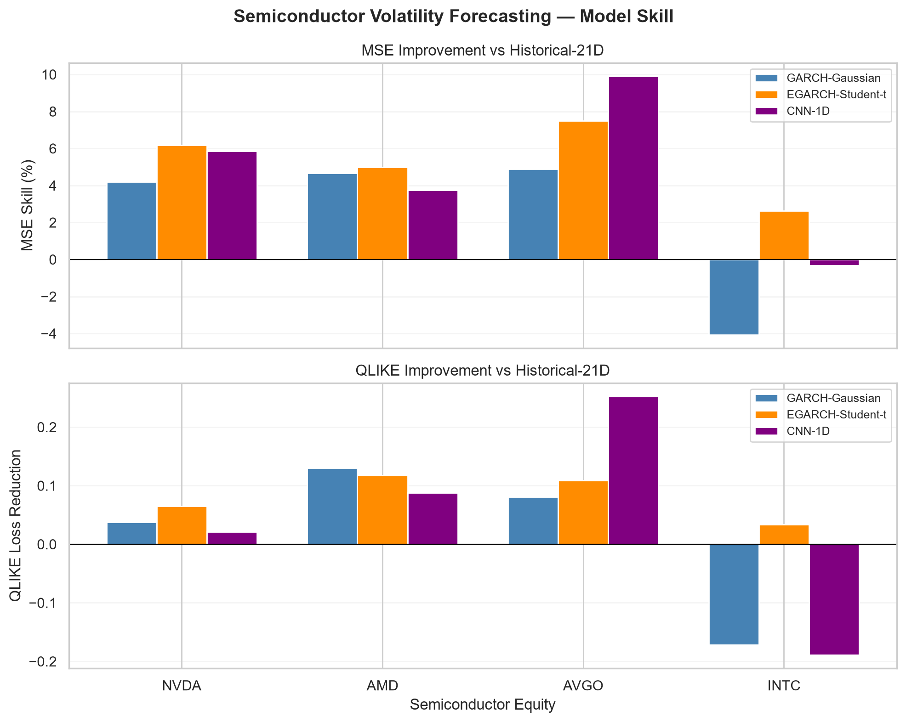
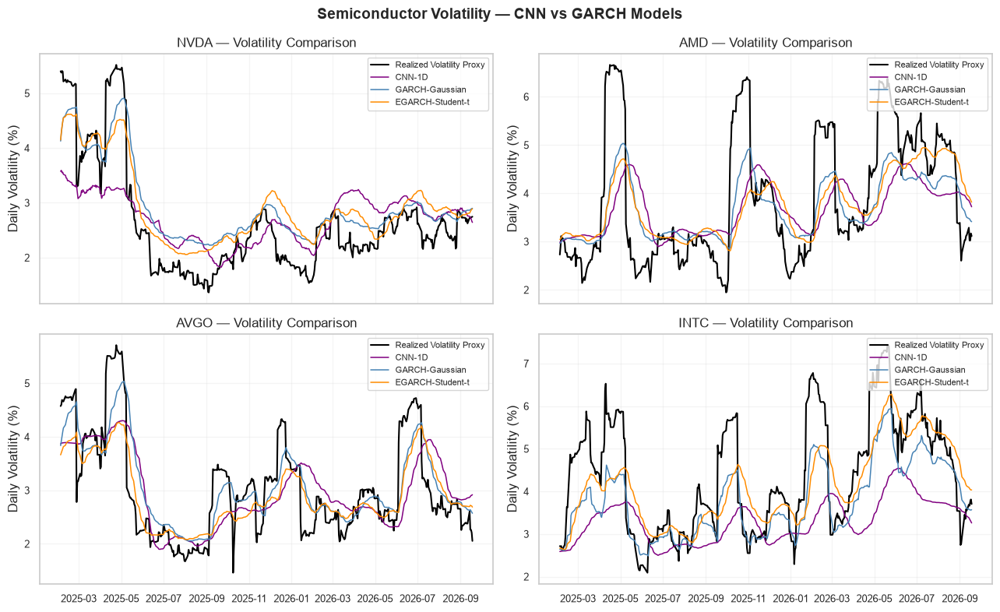

# Semiconductor Volatility Modeling
### GARCH, Asymmetric Risk & CNN Forecast Evaluation

**A financial econometrics and deep-learning research case study** comparing volatility forecasts for **NVDA, AMD, AVGO and INTC**. The goal is to predict the *magnitude of next-day return variability*, **not stock-price direction**.

## Research question

*How well do conditional-volatility models describe and forecast risk across semiconductor equities, and can a compact 1D-CNN outperform established econometric benchmarks?*

## Study design

| Component | Specification |
|---|---|
| Historical sample | January 2018 – September 2026 |
| Forecast test set | 429 trading days, 2 Jan 2025 – 18 Sep 2026 |
| Econometric models | GARCH(1,1), EGARCH(1,1), GJR-GARCH(1,1) |
| Error distributions | Gaussian and Student-t |
| Deep learning | 1D-CNN; 30-day lookback, three return-derived features |
| Benchmarks | Gaussian GARCH, Student-t EGARCH, 21-day historical variance |
| Evaluation | One-step-ahead variance forecasts, MSE, QLIKE |

The GARCH forecasts use expanding historical information with parameter refits every 21 trading days. CNN inputs are standardized using only training data (2018–2023), with validation in 2024 and a held-out test period in 2025–2026. The CNN is not re-trained during testing.

## Main findings

| Stock | Best MSE | Best QLIKE |
|---|---|---|
| NVDA | EGARCH–Student-t | EGARCH–Student-t |
| AMD | EGARCH–Student-t | GARCH–Gaussian |
| AVGO | **1D-CNN** | **1D-CNN** |
| INTC | EGARCH–Student-t | EGARCH–Student-t |

**EGARCH–Student-t is the most consistently competitive benchmark**, while CNN achieves the best overall results for Broadcom (AVGO). The CNN's AVGO advantage is **not stable across years**: its MSE skill over Historical-21D decreases from **11.42% in 2025** to **0.51% in partial 2026**. The results illustrate asset-dependent, time-varying forecast performance rather than a universal winner.

### Forecasting skill relative to a historical baseline

### Volatility forecasts for all four equities

The black lines in the second figure are **ex-post rolling volatility proxies**, not observable conditional variances. Squared returns are noisy risk proxies, so visually smoother curves or lower errors do not automatically establish economic or statistical superiority.

## Reproduce the analysis

1. Create a Python environment (Python version compatible with your TensorFlow installation).
2. Install dependencies: `python -m pip install -r requirements.txt`.
3. Open [`Semiconductor_Volatility_GARCH.ipynb`](Semiconductor_Volatility_GARCH.ipynb) in Jupyter or VS Code and run cells **top to bottom** with an internet connection for `yfinance`.
4. The notebook generates `outputs/overall_forecast_results.csv`, `outputs/annual_forecast_results.csv`, and `outputs/figures/model_skill_comparison.png` when those cells are executed.

Data are downloaded at runtime; no raw vendor dataset is included. Results can change with historical price adjustments, package versions or the stochastic CNN training process. Repeated GARCH estimation may take several minutes.

## Files

- [`Semiconductor_Volatility_GARCH.ipynb`](Semiconductor_Volatility_GARCH.ipynb) — full analysis, plots and written research discussion.
- `outputs/figures/` — selected charts from the saved notebook run.
- `requirements.txt` — Python dependencies.

## Limitations

The 2026 test period is partial; squared returns are an imperfect volatility proxy; the CNN uses a single training seed and fixed weights during testing while GARCH parameters are refitted. Reported score differences are **descriptive**, with no claim of formal statistical significance or trading profitability.

**Conclusion:** Deep learning is a useful competing approach for selected assets, but asymmetric heavy-tailed econometric models remain strong risk-forecasting baselines.
